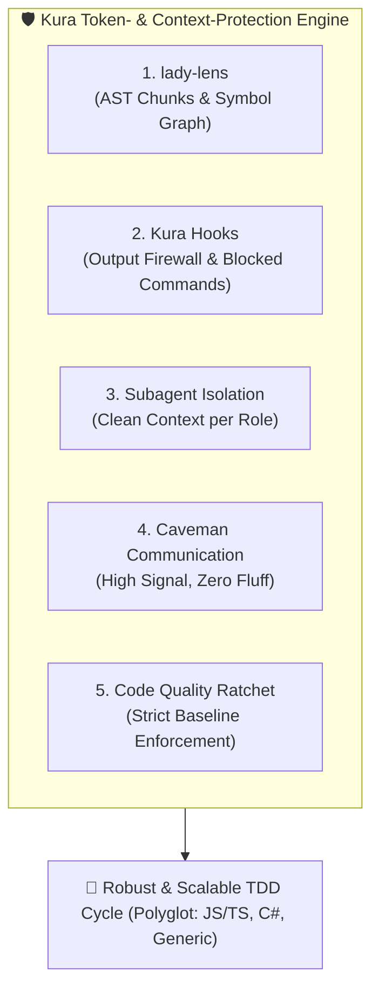
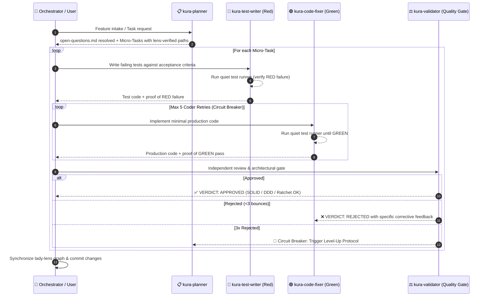

# kura-agent-plugin

> **The Kura Agent Harness Workflow for Any Repository — Polyglot, Token-Efficient, and Uncompromising on Quality.**

---

## The Story: Why This Plugin?

**Kura is an agent harness, not a platform.** It is designed to orchestrate specialized, autonomous AI agents collaborating as a disciplined software engineering outfit — which may down the road evolve into an autonomous agent company or multi-agent team harness.

While the comprehensive Kura harness continues to mature, developers and agents need its rigor **today**. 

This plugin (`kura-agent-plugin`) extracts the battle-tested development flow from Kura and packages it so it can be installed into any repository and run across modern agent environments (Claude Code, Google Antigravity / Gemini CLI).

Originally created around C# .NET microservices, the plugin is now **fully polyglot and generic** — providing equal first-class support for **JavaScript / TypeScript**, **C#**, and other stacks (Python, Go).

---

### The Problem: Token Explosion on Long-Running Agent Tasks

When AI coding agents take on complex, multi-step tasks, they invariably suffer from context decay and token exhaustion:

1. **Context Pollution from Verbose Command Outputs**: Running raw `tests` dumps hundreds of lines of build and test noise into the conversation history. After just 2 or 3 iterations, valuable instructions are pushed out of the context window.
2. **Context Decay in Monolithic Chats**: Having a single agent plan, write tests, code implementations, and self-review results in severe confirmation bias, attention drift, and rapid token bloat.
3. **Blind File Dumps & Shell Scans**: Without a structured code graph, agents repeatedly dump entire files into context or run brute-force filesystem searches (`grep`, `findstr`) across directories like `node_modules` or `.git`.
4. **Conversational Fluff**: Chatty, verbose assistant replies needlessly consume tokens that should be preserved for actual code, contracts, and reasoning.

---

### The Kura Solution: 5 Pillars of Token Preservation & Quality



1. **`lady-lens` Code Graph (AST Chunks & Symbols)**:
   Eliminates bulk file reading. Lady-lens indexes the repository into an AST graph, allowing agents to read only targeted function chunks (`read_chunk`), resolve symbols (`definedIn`, `searchView`), and trace dependencies without reading whole files.
2. **Hooks as an Output & Safety Firewall (`kura-hooks-setup`)**:
   - Intercepts and enforces quiet test commands (`npm run test:quiet` or minimal reporter output) to keep terminal noise out of chat history.
   - Blocks dangerous shell operations (e.g. `git push`, unauthorized external tooling).
   - Guards repository search: prevents slow, token-heavy shell searches on indexed code folders.
   - Provides automatic user-prompt inboxes and pre-compact session snapshots.
3. **Dedicated Subagents with Isolated Contexts (`kura-tdd-subagents`)**:
   Splits work across four specialized subagents: **Planner**, **Test-Writer**, **Code-Fixer**, and **Validator**. Each agent operates in its own fresh context window. Intermediate test failure logs and implementation churn never pollute the orchestrator's chat!
4. **Caveman Style (High Information Density)**:
   Enforces concise, factual communication. Removes boilerplate pleasantries and redundant recaps to maximize token efficiency.
5. **Language-Neutral Quality Ratchet (`kura-rules-setup`)**:
   File sizes, cyclomatic complexity (via `lizard`), and architectural layers are locked to a baseline (`.kura/baseline.json`). Code quality can only improve over time: new rule violations fail immediately.

---

## The Polyglot TDD Subagent Loop

At the heart of the Kura harness is a strict, independent Test-Driven Development loop protected by circuit breakers. The agent implementing the code **never** approves their own work.



### The 4 Subagent Roles in Detail

| Subagent | TypeName | Core Responsibility | Test Command Examples |
|---|---|---|---|
| **Planner** | `kura-planner` | Explores repository via `lady-lens`, clarifies trade-offs in `open-questions.md`, formulates Seam Decisions, and breaks Epics into Micro-Tasks with verified paths. | `lady-lens` (`glob`, `grep`, `searchView`) |
| **Test-Writer** | `kura-test-writer` | **RED Phase**: Writes focused unit/integration tests for every acceptance criterion. Proves tests fail for the right reason. **Never writes production code.** | JS/TS: `npm run test:quiet` or `node --test`<br/>C#: `dotnet test --logger:"console;verbosity=quiet"` |
| **Code-Fixer** | `kura-code-fixer` | **GREEN Phase**: Writes minimal, clean production code to pass tests adhering strictly to the Seam Decisions. Max 5 retry attempts. | Same quiet test command |
| **Validator** | `kura-validator` | **Gatekeeper**: Independent reviewer. Evaluates code against architecture rules, checks for skipped/weakened tests, and verifies the quality ratchet. | Test suite + `node .kura/rules-check.mjs check` |

### Circuit Breakers & Level-Up Escalation Protocol

To prevent agents from spinning in unproductive loops:
1. **5x Coder Retry Limit**: If a coder fails to turn tests green after 5 attempts, the loop halts immediately.
2. **3x Review Bounce Limit**: If the validator rejects an implementation 3 times, no 4th coder attempt is made. The task escalates.
3. **Level-Up Hierarchical Escalation**:
   - *Stuck at Code level?* → Step back to **Task Definition** (is the micro-task too broad or unclear?).
   - *Stuck at Task level?* → Step back to **Sub-story level** (is an interface, port, or seam missing?).
   - *Stuck at Sub-story level?* → Escalate to **Main Story / `open-questions.md`** to confer with the human architect.

---

## Persistent State Management: The Kura Triad

Complex engineering tasks frequently span multiple days, sessions, and context compactions. Kura guarantees zero memory decay through a synchronized triad of lightweight, human-readable markdown files:

| Artifact | Default Location | Role & Purpose |
|---|---|---|
| **Now / Nu Bezig** | `backlog/now.md` | **Active Focus & Pre-Compact Snapshot**: Tracks the single task currently in flight. Before any context compaction or session end, hooks append an automatic git snapshot (`<!-- auto-snapshot -->`) capturing uncommitted diffs and changed files so the agent instantly re-orients upon wakeup. The `Stop` hook also verifies this file was updated today before finishing. |
| **Inbox** | `backlog/inbox.md` | **Automatic Request Queue**: Every substantive user prompt (> 12 words) is automatically captured with a timestamp. Unfinished items (`- [ ]`) are surfaced at `SessionStart` briefing so no user requirement, bug report, or idea is forgotten. |
| **Open Questions** | `open-questions.md`<br/>*(or `openvragen.md`)* | **Persistent Decision Log**: All architectural trade-offs, domain assumptions, and design choices are logged here before code is written. Once answered by the user, the decision and rationale are permanently preserved, preventing agents from re-asking the same questions across subsequent sessions. |

---

## Supported Stacks & Multi-Language Architecture

The plugin automatically adapts to your project's technology stack:

### JavaScript & TypeScript
* **Test Runners**: Node.js test runner (`node --test`), Vitest (`vitest run`), Jest (`jest --silent`).
* **Hexagonal Architecture**: Ports & Adapters (Inference, Graph, Coder, Flow, Reviewer) ensuring core logic has zero external I/O imports.
* **Fractal Composition**: 3-tier composition (frozen module factories, neutral subsystem DTOs, and runtime composition with state-dependent tool capabilities).
* **Rule Engines & State Machines**: Named rule tables (`decide(ctx, rules)`) with pure guards (`all`, `any`, `not`) replacing if-ladders, plus pure workflow reducers (`step(state, event) => { state, effects }`).
* **Design Patterns**: Decorator (transparently wrapping ports with retries/metrics/caching) and Visitor (AST and task tree operations without node pollution).
* **Quality Ratchet**: ESLint baselines, import boundaries between layers, no dump folders (`utils/`), and function complexity enforcement.

### C# & .NET
* **Test Runners**: `dotnet test --logger:"console;verbosity=quiet"`, xUnit, NUnit, FluentAssertions.
* **Hexagonal Architecture**: Domain core decoupled from EF Core and external I/O via Port interfaces and shared abstract adapter contract tests.
* **Architecture & Standards**: DDD immutable records (`record struct` / `sealed record`), composition over inheritance, strongly typed IDs.
* **Rule Engine & State Machines**: Composable predicates (`All`, `Any`, `Not`) with named rule records for observable decision-making, plus pure workflow reducers (`Step`).
* **Design Patterns**: Decorator (wrapping ports with caching/resilience), Visitor (AST/tree traversals), and lightweight dispatcher ([`kimVanRenterghemNew/mediator2`](https://github.com/kimVanRenterghemNew/mediator2)).
* **Async Resilience**: Mandatory `CancellationToken` in async signatures, stateless services, and clean timeout handling.

### Polyglot (Python, Go, Kotlin, Java, Rust, PHP, etc.)
* The **rules checker** (`rules-check.mjs`) is language-neutral: it parses imports via regex and analyzes cyclomatic complexity using `lizard`.

---

## Command & Skill Catalog

| Command / Skill | Purpose & Description |
|---|---|
| **`/kura [task]`** | Central hub command: interactive menu or entry point to start the development workflow, planning, hooks, or rules. |
| **`/kura:kura-dev <task>`** | Full development lifecycle: Planning → Seams → TDD Subagents (Red/Green/Validate) → Synchronization. |
| **`kura-dev`** | Master polyglot orchestrator: coordinates the 4-agent team (planner, test-writer, code-fixer, validator) across any stack. |
| **`/kura:kura-plan <task>`** | Planning & intake only: manages `open-questions.md`, records into `backlog/inbox.md`, decomposes micro-tasks with lens paths. |
| **`/kura:kura-hooks`** | Automated wizard to configure repo-specific hooks (quiet tests, blocked commands, search guard). |
| **`/kura:kura-rules`** | Initializes `.kura/rules.json` and creates `.kura/baseline.json` code ratchet. |
| **`/kura:kura-ponytail [level]`** | Switches ponytail intensity level (`lite`, `full`, `ultra`, `off`). Lazy senior dev mode. |
| **`kura-ponytail`** | Lazy senior developer skill: smallest complete change, ruthless YAGNI, deletion beats addition. |
| **`kura-backlog-planning`** | Requirements intake, universal auto-inbox, and hierarchical Epic → Sub-stories → Micro-Tasks decomposition. |
| **`kura-tdd-subagents`** | Isolated test-writer → code-fixer → validator subagent cycle with circuit breakers (max 5 retries, max 3 bounces). |
| **`kura-caveman`** | Ultra-concise, high-density communication style skill to prevent context window token bloat. |
| **`kura-js-architecture`** | JavaScript & TypeScript standards: Ports & Adapters, contract testing, and anti-pattern/dump-folder prevention. |
| **`kura-csharp-architecture`** | C# .NET standards: Seam Decisions, SOLID, DDD immutable records, and mediator2 patterns. |
| **`kura-lens-setup`** | Cross-platform setup and verification of [lady-lens](https://www.npmjs.com/package/lady-lens) code graph MCP tooling. |
| **`kura-hooks-setup`** | Generates repo-specific Claude Code & Git hooks tailored to your stack and operating system. |
| **`kura-rules-setup`** | Installs the language-neutral code quality ratchet (`rules-check.mjs` + `baseline.json`). |

---

## Installation & Usage

### In Claude Code

```text
/plugin marketplace add kimVanRenterghemNew/kura-agent-plugin
/plugin install kura@kura-agent-plugin
```

Or add the marketplace via its git URL:
```text
/plugin marketplace add git@github.com:kimVanRenterghemNew/kura-agent-plugin.git
```

Restart Claude Code after installation, then run:
```text
/kura:kura-dev "Implement order cancellation feature"
```

### In Google Antigravity / Gemini CLI

Because Antigravity natively supports `define_subagent`, `invoke_subagent`, and `lady-lens` MCP tools, the orchestrator and skills can be invoked directly:
* Prompt the assistant: *"Start the kura-dev workflow for task X"* or *"Install the Kura hooks and rules in this repository"*.

---

## Opt-in Hooks Setup

The plugin never installs active hooks without consent. Asking the agent to *"Set up the Kura hooks"* triggers the `kura-hooks-setup` skill: it detects your stack (npm, dotnet, python), asks which hooks you want, and generates tailor-made scripts in `.claude/hooks/repo-hooks.mjs` and `.githooks/pre-commit`.

---

## Requirements

* **Claude Code** or **Antigravity CLI**
* **Node.js 18+** (for hooks and rules checker)
* **Optional**: [lady-lens](https://www.npmjs.com/package/lady-lens) (`npm install -g lady-lens`) for AST code graph navigation
* **Optional**: [lizard](https://github.com/terryyin/lizard) (`pip install lizard`) for multi-language cyclomatic complexity checks

---

## License

MIT © Kim Van Renterghem
