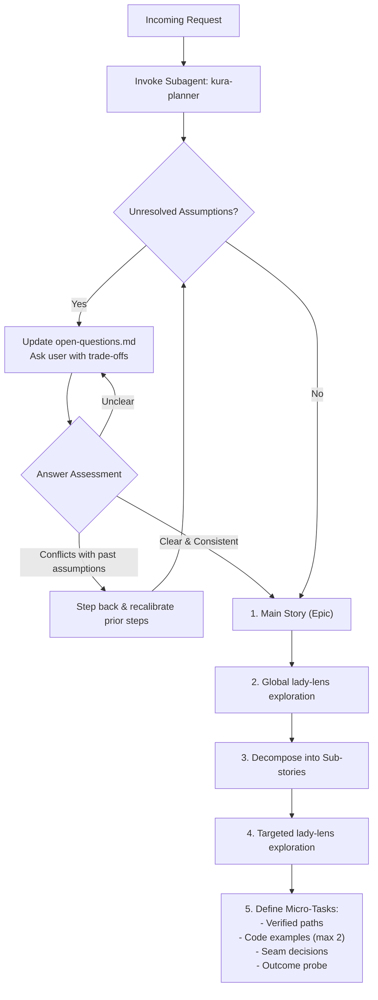

# Kura Backlog Planning & Intake Skill

This skill enforces disciplined requirements breakdown, explicit decision management, and hierarchical planning through the dedicated **`kura-planner`** subagent before code implementation.

---

## The Planning Flow



---

## 1. Defining the `kura-planner` Subagent

The orchestrator registers `kura-planner` using `define_subagent`:

```json
{
  "Name": "kura-planner",
  "Description": "Specialist software architect and requirements engineer that manages open-questions.md, explores code via lady-lens, and produces hierarchical backlog items.",
  "SystemPrompt": "You are a Senior Software Architect in Kura. Your role is requirements analysis, codebase exploration via lady-lens, open questions management (open-questions.md), and hierarchical planning (Epic -> Sub-stories -> Micro-Tasks). You must never write production code or guess file paths. You strictly ground every task in real lady-lens paths and max 2 code examples. You formulate Story 33 Seam Decisions adhering to SOLID, DDD records, and mediator2.",
  "EnableWriteTools": true,
  "EnableMCPTools": true,
  "EnableSubagentTools": false
}
```

---

## 2. Universal Auto-Inbox Protocol (Every Agent)

To ensure no user requirements, decisions, or architectural requests are lost during long sessions or across context compactions:

1. **Record Structural Requests in `backlog/inbox.md`**:
   - Any agent (Claude Code, Antigravity, Cursor, etc.) receiving a substantial request (> 12 words, not a simple confirmation like "ok" or "proceed") must ensure it is logged in `backlog/inbox.md`.
   - Format: `- [ ] YYYY-MM-DD HH:MM <Request summary or verbatim prompt>`
2. **Review Open Items on Start**:
   - At the beginning of a planning session, inspect `backlog/inbox.md` for uncompleted tasks (`- [ ]`). Check them off (`- [x]`) once decomposed into backlog items.

---

## 3. Intake & Open Questions Log (`open-questions.md` / `openvragen.md`)

All questions, assumptions, and user trade-offs are documented in `open-questions.md` (or `openvragen.md` in Dutch repositories). This ensures questions and decisions are never lost between sessions or context compactions:

1. **Document Every Non-Trivial Decision**: Never make silent assumptions regarding domain boundaries, APIs, or infrastructure. Track them in `open-questions.md` / `openvragen.md`.
2. **Present Options to the User**: Frame each choice with clear architectural trade-offs and an explicit recommended option.
3. **Assess Clarity & Consistency**:
   - **Clear & Consistent**: Incorporate into the backlog item and mark the question resolved with the user's decision and rationale.
   - **Clear, but conflicts with past assumptions**: **Step back!** Re-evaluate the earlier planning steps that relied on the invalidated assumption.
   - **Unclear / Ambiguous**: Ask a targeted follow-up question immediately.
4. **Permanent Decision Memory**: Future agent sessions inspect `open-questions.md` / `openvragen.md` first, preventing the model from re-asking already answered design choices.

Template: [Open Questions Template](./templates/open-questions-template.md).

---

## 4. Hierarchical Story Decomposition

### Step 1: Main Story (Epic)
- Formulate the User Story: `As a [role] I want [action] So that [value]`.
- Explicitly define the **Out of Scope** boundary.

### Step 2: Global lady-lens Exploration
- Locate existing modules and contracts using lady-lens tools:
  - `call_mcp_tool(lady-lens, grep, { pattern: "public interface ...", repo: "<repo_id>" })`

### Step 3: Sub-stories Breakdown
- Divide the epic into small, independent, testable sub-stories.

### Step 4: Targeted lady-lens Exploration
- Identify exact files impacted:
  - `call_mcp_tool(lady-lens, definedIn, { symbol: "OrderService" })`
  - `call_mcp_tool(lady-lens, importedBy, { file: "src/Services/OrderService.cs" })`

### Step 5: Micro-Tasks Definition
Every task must specify:
1. **Verified Paths**: Real file paths verified via lady-lens (`exists` / `glob`). No invented paths!
2. **Code Examples (Max 2)**: Snippets or file paths from the repository serving as style/pattern reference.
3. **Seam Decisions**: Architectural choices (see `kura-csharp-architecture` skill).
4. **Acceptance Criteria**: Concrete checkboxes verifying happy path, edge cases, and failure modes.
5. **Outcome Probe**: Concrete test command (`dotnet test --filter ...`).

Template: [Backlog Item Template](./templates/backlog-item-template.md).
