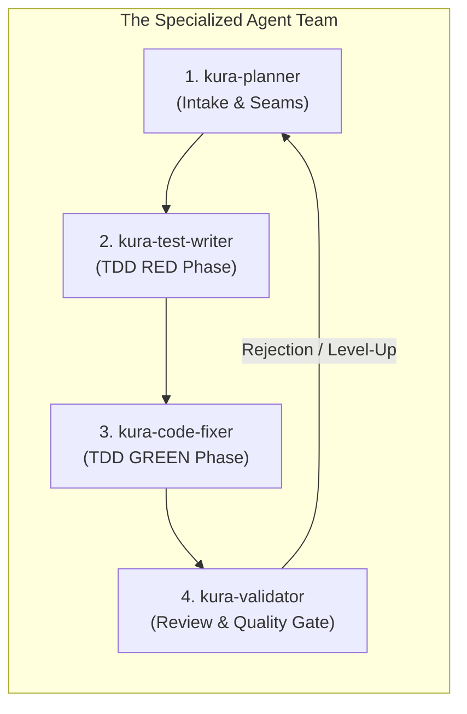
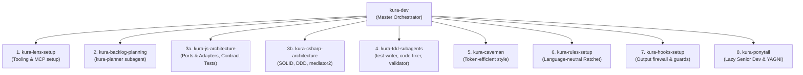

# Kura Master Development Workflow (Polyglot)

This orchestrator skill brings together specialized sub-skills and a dedicated **4-Agent Team** to guide developers and agents through the full engineering lifecycle of software in any repository.

---

## The 4-Agent Team Architecture

To guarantee objectivity, avoid context pollution, and eliminate shortcuts, work is distributed across four specialized, isolated subagents:

| Subagent | Role | Responsibility & Tools |
|---|---|---|
| **`kura-planner`** | Requirements Architect | Explores code via `lady-lens`, manages `open-questions.md`, logs requests in `backlog/inbox.md`, formulates Seam Decisions, and breaks down Epics into Sub-stories & Tasks with verified paths. |
| **`kura-test-writer`** | TDD Test Engineer | Writes unit/integration tests covering all acceptance criteria. Proves test failure (**RED**) with quiet test runner (`npm run test:quiet`, `dotnet test`). Never writes production code. |
| **`kura-code-fixer`** | Software Engineer | Implements minimal production code according to Seam Decisions (Ports & Adapters, SOLID, DDD records). Proves tests turn **GREEN**. Max 5 retries. |
| **`kura-validator`** | Reviewer & Gatekeeper | Independent quality gatekeeper. Validates acceptance criteria, architectural rules, and ratchet. Enforces the 3x review bounce limit and Level-Up protocol. |

---

## Modular Sub-Skills Architecture

| Sub-Skill | Role & Purpose | Direct Link |
|---|---|---|
| **`kura-lens-setup`** | Automated installation of `lady-lens` across Windows & Linux/macOS, registering repos (`lens add`), and connecting agent MCP configurations (`lens install`, `lens install --skill`). | [kura-lens-setup](../kura-lens-setup/SKILL.md) |
| **`kura-backlog-planning`** | Requirements intake, universal auto-inbox (`backlog/inbox.md`), `open-questions.md` management, and hierarchical story breakdown with **`kura-planner`**. | [kura-backlog-planning](../kura-backlog-planning/SKILL.md) |
| **`kura-js-architecture`** | JavaScript & TypeScript standards: Hexagonal Ports & Adapters, Fractal Composition, Rule Engines & State Machines, Decorator & Visitor patterns, and contract testing. | [kura-js-architecture](../kura-js-architecture/SKILL.md) |
| **`kura-csharp-architecture`** | C# .NET standards: Hexagonal Ports & Adapters, SOLID, DDD records, Rule Engines & State Machines, and `mediator2`. | [kura-csharp-architecture](../kura-csharp-architecture/SKILL.md) |
| **`kura-tdd-subagents`** | Orchestration of **`kura-test-writer`**, **`kura-code-fixer`**, and **`kura-validator`**, with 3x review bounce limit, 5x retry circuit breaker, and Level-Up protocol. | [kura-tdd-subagents](../kura-tdd-subagents/SKILL.md) |
| **`kura-caveman`** | Ultra-concise communication style to prevent context bloat and token exhaustion. | [kura-caveman](../kura-caveman/SKILL.md) |
| **`kura-ponytail`** | Lazy senior dev mode: smallest complete change, ruthless YAGNI, deletion beats addition. | [kura-ponytail](../kura-ponytail/SKILL.md) |
| **`kura-rules-setup`** | Universal code quality ratchet (`rules-check.mjs` + `baseline.json`). | [kura-rules-setup](../kura-rules-setup/SKILL.md) |
| **`kura-hooks-setup`** | Configurable repository hooks for output filtering, quiet tests, and safety guards. | [kura-hooks-setup](../kura-hooks-setup/SKILL.md) |

---

## End-to-End Execution Sequence

### Phase 0: Prerequisites & Tooling Setup
- Detect local environment and verify `lady-lens` availability (`lens status` / `lens sync`).
- If missing, run cross-platform setup via `kura-lens-setup`.

### Phase 1: Planning with `kura-planner`
1. Log prompt to `backlog/inbox.md` if not present.
2. Clarify open questions with the user via `open-questions.md`.
3. Decompose feature: **Main Story (Epic) → Sub-stories → Micro-Tasks**.
4. Verify every file path using lady-lens tools (`exists`, `glob`, `grep`).
5. Formulate Seam Decisions (calling `kura-js-architecture` or `kura-csharp-architecture`).

### Phase 2: TDD Implementation Loop
For each micro-task from the backlog:
1. **Red Phase**: Invoke `kura-test-writer` → Writes failing tests and verifies RED failure via quiet test runner.
2. **Green Phase**: Invoke `kura-code-fixer` → Writes minimal code until tests pass quietly (max 5 attempts).
3. **Review & Gate Phase**: Invoke `kura-validator` → Evaluates implementation against architectural rules and quality ratchet.
   - If rejected: Coder fixes (max 3 bounces).
   - If 3rd rejection occurs: Circuit breaker triggers escalation back to `kura-planner`.

### Phase 3: Validation & Graph Synchronization
- If progress stalls: `kura-validator` triggers the **Level-Up Protocol** (Task → Sub-story → Main Story).
- Run quality ratchet check (`node .kura/rules-check.mjs check`).
- Once satisfied: update backlog and synchronize graph (`repo_sync`).
