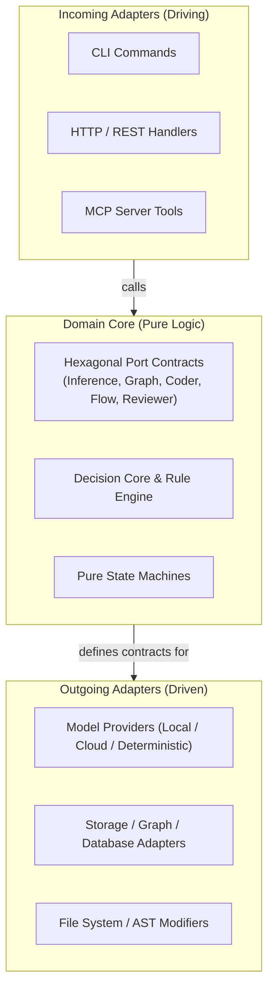

# Kura JavaScript & TypeScript Architecture Skill

This skill provides architectural standards, pattern implementations, and quality guidelines for JavaScript and TypeScript projects within Kura. It brings together **Hexagonal Architecture (Ports & Adapters)**, **Fractal Composition**, **Pure Rule Engines & State Machines**, and classic behavioral patterns (**Decorator**, **Visitor**, **Strategy**) in a modern, lightweight, functional style.

---

## 1. The Three Golden Rules of Modular Architecture

1. **Universal Pluggability ("Everything is a Port")**:
   No business logic outside the composition root knows what concrete technology is running underneath. An inference call (local LLM, cloud model, deterministic rule), a database query, or a code modification must go through **the exact same port contract**.
2. **Fractal Composition**:
   Composition occurs consistently at every level:
   - *Internal to modules*: pure functions, micro-adapters, named rules, tagged errors (no `class` hierarchies).
   - *Between modules*: bounded subsystems assembled via ports and neutral DTOs.
   - *System-wide*: centralized composition root, dynamically enrichable via `compose(runtime, behavior)`.
3. **Robust Flow with Pure State Machines**:
   Workflows (`Architecture ⇄ Plan ⇄ Coding ⇄ Review ⇄ Validation ⇄ Done`) are modeled as pure, deterministic state machines (`step(state, event) => { state, effects }`). A quality gatekeeper or reviewer can trigger an immediate rollback (e.g. from *Coding* back to *Architecture*) without mutating individual module internals.

---

## 2. Hexagonal Architecture (Ports & Adapters)



### Core Port Contracts:
* **`InferencePort`**: Generates text, handles structured chat, or evaluates decisions across local models, cloud APIs, deterministic AST rules, or offline test fixtures.
* **`GraphStorePort` / `StoragePort`**: Persists and queries graphs, entities, or relations; caller never knows if storage is in-memory, SQLite, LadybugDB, or JSON files.
* **`CoderPort`**: Encapsulates code transformation (interactive loop, external agentic worker, or deterministic AST codemod).
* **`FlowPort`**: Coordinates development workflows and pipelines as pure state machines.
* **`ReviewerPort`**: Evaluates code and architecture against rules, baselines, and AST constraints.

---

## 3. Fractal Composition: Three Levels

### Level 1: Internal Module Composition (Pure, No `class`)
- **No `class`**: Factories return frozen objects (`Object.freeze(...)`) or use prototype composition. This avoids rigid design-time inheritance hierarchies.
- **Tagged Errors**: Errors are plain Error instances enriched with machine-readable error codes (`{ code: 'ERR_PORT_VIOLATION' }`). Never subclass Error.
- **No Ambient Globals**: Never access `process.env`, `console`, or module singletons directly in core logic. Pass dependencies via parameters or a single `ctx` context object.
- **Fail-Closed**: If no explicit rule matches, throw a tagged error (`NO_RULE_MATCHED`); never silently pass unexpected input.

### Level 2: Subsystems, Pipelines & Neutral DTOs
- Modules communicate across bounded context boundaries exclusively via explicit, neutral **DTOs** (`ContextDTO`, `PlanDTO`, `TaskDTO`, `ReviewDTO`).
- Multi-step processes are chains of pure functions: `pipe(...stages)(ctx)`.

### Level 3: Runtime Composition & State-Dependent Capabilities
- The composition root binds concrete adapters to ports once at startup.
- **State-Dependent Tool Exposure**: An agent in the planning/architecture state has only research/read-only capabilities. Code mutation tools are physically absent from the runtime until the state transitions to *coding*. This saves token context and prevents premature code modifications.

---

## 4. The Decision Core & Rule Engine Pattern

Replace nested `if/else` ladders and messy status branches with composable, observable **Named Rule Engines**:

```javascript
// Composable Pure Guards
const all = (...guards) => ctx => guards.every(g => g(ctx));
const any = (...guards) => ctx => guards.some(g => g(ctx));
const not = guard => ctx => !guard(ctx);

// Named Rules Table: First matching rule wins; returns the rule name for observability
const DECISION_RULES = [
  { name: 'max_retries_exceeded', when: ctx => ctx.attempts >= 5, then: { action: 'escalate', reason: 'circuit_breaker' } },
  { name: 'has_unresolved_tradeoffs', when: ctx => ctx.openQuestions.length > 0, then: { action: 'ask_user' } },
  { name: 'ready_for_tdd', when: ctx => ctx.planApproved && ctx.tasksVerified, then: { action: 'start_red_phase' } },
  { name: 'default_review', when: () => true, then: { action: 'replan' } }
];

export const decide = (ctx, rules = DECISION_RULES) => {
  const match = rules.find(r => r.when(ctx));
  if (!match) throw Object.assign(new Error('No matching rule'), { code: 'NO_RULE_MATCHED' });
  return { ...match.then, rule: match.name };
};
```

---

## 5. Structural & Behavioral Patterns: Decorator & Visitor

### The Decorator Pattern (Wrapping Ports Transparently)
Use decorators to add cross-cutting concerns around ports without touching core business logic or adapter code:
- **Logging & Metrics Decorator**: Records execution latency, token counts, and input/output payloads.
- **Circuit Breaker / Retry Decorator**: Transparently handles exponential backoff or fails fast on timeouts.
- **Caching Decorator**: Caches expensive AST lookups or model responses in memory.

### The Visitor Pattern (AST & Hierarchical Traversals)
Use visitor functions to traverse and operate over complex structures (ASTs, dependency graphs, composite task trees) without polluting the underlying nodes:
- Decouples traversal mechanics from node operations (e.g. `visitTree(node, { onTask, onStory, onEpic })`).
- Allows adding new operations (formatting, linting, complexity checks) without altering entity definitions.

---

## 6. Behavior-First Testing & Conventions

1. **Test User Capabilities, Not Implementation**:
   - Write tests that describe *what the consumer or user can do* (Behavior-Driven Development).
   - Tests do not assert on private function names, internal regex patterns, or database structures.
2. **Contract Tests per Adapter**:
   - Every port implementation (real adapter, local double, mock) must run and pass the **exact same contract test suite** (`*.contract.test.js`).
3. **Strict Module Boundaries**:
   - A folder is a module. Its `index.js` is the public API.
   - Code outside a module **only imports `index.js`**, never module internals.
4. **Architectural Ratchet**:
   - Maximum lines per file (target $\le 250$ lines).
   - Maximum cyclomatic complexity per function (via `lizard`).
   - Ratchet baseline (`.kura/baseline.json`) ensures violations can only decrease over time.

Reference: [JavaScript / TypeScript Patterns & Implementation Examples](./references/js-ts-patterns.md).
