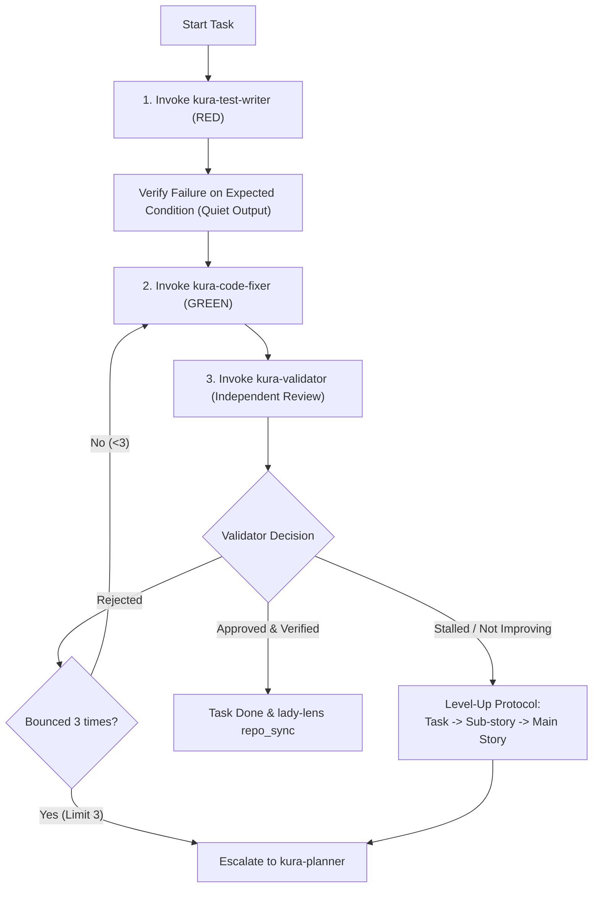

# Kura TDD Subagents & Verification Engine Skill (Polyglot)

This skill enforces strict Test-Driven Development (TDD) and quality control by registering and delegating to **dedicated, isolated Subagents** with rigid circuit breakers and escalation mechanisms. It supports **JavaScript/TypeScript**, **C#**, and other stacks.

---

## The Subagent Team (Role Separation & Context Isolation)

Having distinct agents prevents bias ("the author approving their own code") and isolates context windows to prevent token bloat:

| Subagent | Role | Responsibility | Test Command Examples |
|---|---|---|---|
| **`kura-test-writer`** | TDD Test Engineer | Writes unit/integration tests against acceptance criteria, verifies failure (**RED**). Never writes production code. | JS/TS: `npm run test:quiet` or `node --test`<br/>C#: `dotnet test --logger:"console;verbosity=quiet"` |
| **`kura-code-fixer`** | Software Engineer | Implements minimal production code to pass tests (**GREEN**). Max 5 attempts (Circuit Breaker). | Same quiet test command |
| **`kura-validator`** | Code Reviewer & Gatekeeper | Independent validation against architectural conventions, quality ratchet, and test suite. Enforces 3x review bounce limit and Level-Up protocol. | Test suite + `node .kura/rules-check.mjs check` |

---

## The Execution & Verification Lifecycle



---

## 1. Defining the Specialized Subagents

The orchestrator registers the subagents using `define_subagent` (configured for the repo's stack):

### Agent 1: `kura-test-writer` (Red Phase)
```json
{
  "Name": "kura-test-writer",
  "Description": "Specialist TDD test engineer that writes unit and integration tests (RED phase) before production code is written.",
  "SystemPrompt": "You are a senior Test Engineer within Kura. Your SOLE responsibility is to write thorough, failing tests (TDD Red Phase) adhering to project conventions and lady-lens exploration. You MUST run the quiet test runner (e.g. npm test, vitest run, or dotnet test) to prove tests fail for the expected reason. You must NEVER write production implementation code.",
  "EnableWriteTools": true,
  "EnableMCPTools": true,
  "EnableSubagentTools": false
}
```

### Agent 2: `kura-code-fixer` (Green Phase)
```json
{
  "Name": "kura-code-fixer",
  "Description": "Specialist software engineer that implements minimal, clean production code according to Seam Decisions (GREEN phase).",
  "SystemPrompt": "You are an experienced Software Engineer working in Kura. Your SOLE task is to write the minimal production code to turn failing tests GREEN. You strictly adhere to Seam Decisions (for JS/TS: Ports & Adapters, functional/OOP decomposition; for C#: SOLID, DDD records, mediator2). You must run the quiet test command to prove tests pass (100% GREEN). Max 5 attempts before circuit breaker.",
  "EnableWriteTools": true,
  "EnableMCPTools": true,
  "EnableSubagentTools": false
}
```

### Agent 3: `kura-validator` (Review & Quality Gate)
```json
{
  "Name": "kura-validator",
  "Description": "Independent code reviewer and quality assurance gatekeeper. Evaluates code against acceptance criteria, architecture, and quality ratchet.",
  "SystemPrompt": "You are an independent Senior QA & Architecture Reviewer in Kura. You review code produced by kura-code-fixer against: 1. Acceptance criteria completion, 2. Architectural conventions (clean boundaries, no weakened tests), 3. Quality ratchet (rules-check.mjs), 4. Full test suite passing quietly. If criteria are not met, provide precise feedback. If rejected 3 times, trigger escalation to kura-planner.",
  "EnableWriteTools": true,
  "EnableMCPTools": true,
  "EnableSubagentTools": false
}
```

---

## 2. Invoking the Subagents (Execution Flow)

For each micro-task:
1. `invoke_subagent({ "TypeName": "kura-test-writer", "Role": "TDD Test Engineer", "Prompt": "..." })`
   - Must return failing test output (**RED**).
2. `invoke_subagent({ "TypeName": "kura-code-fixer", "Role": "Software Engineer", "Prompt": "..." })`
   - Must return passing test output (**GREEN**).
3. `invoke_subagent({ "TypeName": "kura-validator", "Role": "Code Reviewer & Gatekeeper", "Prompt": "..." })`
   - Verifies compliance. Approves or requests changes.

---

## 3. Circuit Breakers & Level-Up Protocol

1. **Review Bounce Limit (Max 3 Times)**:
   - If `kura-validator` rejects the code 3 times:
     **STOP.** Do not bounce back to the coder again. Escalate back to `kura-planner`.
2. **Coder Verification Limit (Max 5 Retries)**:
   - If after 5 attempts tests still fail:
     **STOP.** Escalate back to `kura-planner`.
3. **Level-Up Hierarchical Escalation**:
   - Stuck at Code level? → Step back to **Task Definition**.
   - Stuck at Task level? → Step back to **Sub-story level**.
   - Stuck at Sub-story level? → Step back to **Main Story / `open-questions.md`**.

Prompts & Templates: [Subagent Prompt Templates](./templates/subagent-prompts.md).
